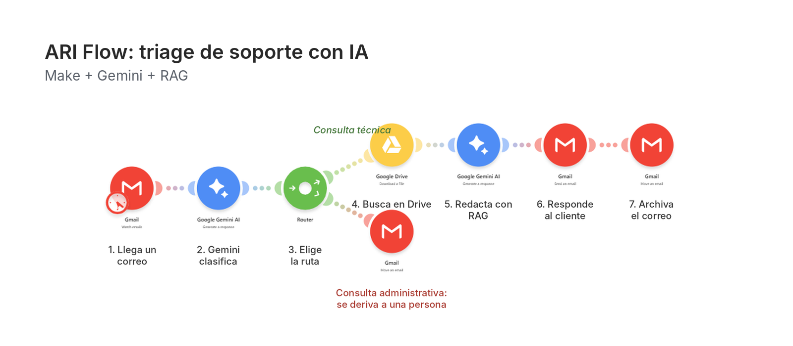

# Agentes de IA para procesos de negocio

Tres agentes construidos para **ARI Consulting**, una consultora ficticia de Oracle, durante la *Inmersión: Agentes de IA para Negocios* de Oracle Next Education (Oracle + Alura Latam, 2026). Cada uno ataca una tarea repetitiva distinta: responder consultas de soporte, armar propuestas comerciales y monitorear noticias del mercado. Después reconstruí el agente de soporte en **Python**, con base vectorial y webhook, para pasar del prototipo sin código a un servicio que se puede probar y evaluar.

`Python` · `Make` · `Google Gemini API` · `RAG` · `Chroma` · `FastAPI` · `ChatGPT (Custom Instructions)` · `Google Opal` · `Prompt engineering`

## Los agentes

| Agente | Qué resuelve | Cómo | Evidencia |
|---|---|---|---|
| [**ARI FLOW**](03_ARI_FLOW_Agent) · soporte | Clasifica los correos entrantes: responde solo las consultas técnicas y deriva el resto a una persona | Make + Gemini: un clasificador, un enrutador y una respuesta con RAG sobre una base de conocimiento | [Escenario en Make](https://us2.make.com/public/shared-scenario/Na1q5dCZWHq/ari-flow-inmersion), [blueprint](03_ARI_FLOW_Agent/blueprint.json) y [kit de evaluación](03_ARI_FLOW_Agent/evaluacion) |
| [**ARI FLOW en Python**](04_ARI_FLOW_Python) · soporte | El mismo triage, pero el clasificador ve la base antes de decidir: responde solo lo que la base cubre | Chroma + Gemini + FastAPI: recuperar, decidir (JSON + reglas en código) y responder citando la sección | [Código](04_ARI_FLOW_Python), 9 pruebas y [evaluación con los mismos 30 casos](04_ARI_FLOW_Python#evaluación) |
| [**ARI DEAL**](02_ARI_DEAL_Agent) · comercial | Genera propuestas comerciales en Word a partir de un briefing, validando presupuesto y plazos | ChatGPT con instrucciones personalizadas, plantilla y catálogo como base de conocimiento; empaquetado como *skill* | [2 videos de prueba](02_ARI_DEAL_Agent) y 2 propuestas generadas |
| [**ARI NEWS**](01_ARI_NEWS_App) · inteligencia de mercado | Arma un panel con las 3 noticias más relevantes de un sector, región y fecha | Google Opal: 4 nodos (búsqueda, control de calidad de links, imagen y página HTML) | Prompts de cada iteración documentados |

## Qué aprendí construyéndolos

- **Separar clasificar de responder.** En ARI FLOW, un primer modelo solo decide la ruta (SI/NO) y un segundo redacta la respuesta. Así la derivación a una persona no depende de que el modelo "se dé cuenta" mientras escribe.
- **La primera versión casi nunca alcanza.** En ARI NEWS, un único prompt devolvía links rotos; la solución fue dividir el trabajo en nodos especializados, uno de ellos dedicado solo a validar URLs.
- **Un agente se evalúa con casos de prueba, no con una demo.** Por eso ARI FLOW tiene un set de 30 correos etiquetados y un script que mide a qué carpeta fue cada uno.
- **Que el clasificador vea la base antes de decidir.** En Make, el clasificador preguntaba "¿es sobre Oracle?" y podía mandar a respuesta automática consultas que la base no cubre. En la versión en Python recibe los fragmentos recuperados y decide si alcanzan, y las reglas de derivación se verifican también en código.

## Evaluación de ARI FLOW

El [kit de evaluación](03_ARI_FLOW_Agent/evaluacion) tiene 30 correos en cuatro grupos: consultas que la base de conocimiento cubre, consultas de Oracle que **no** cubre, consultas administrativas y casos ambiguos. El script `evaluar.py` calcula la exactitud del enrutamiento, la calidad de las respuestas automáticas y lista los correos que el agente respondió cuando debía derivarlos.

**Un riesgo que el set está diseñado para medir:** el clasificador responde SI ante cualquier consulta de Oracle Cloud (HCM, ERP, SCM…), pero la base de conocimiento solo cubre **Oracle Sales**. Una consulta sobre sueldos en Oracle HCM iría a la ruta automática sin información para contestarla.

## Limitaciones

- Son prototipos sobre una empresa ficticia, no sistemas en producción.
- ARI FLOW clasifica con el *snippet* del correo (las primeras líneas), no con el cuerpo completo.
- ARI FLOW en Python todavía no tiene cargados los resultados de la evaluación con Gemini.
- ARI DEAL y ARI NEWS dependen de plataformas cerradas (ChatGPT y Google Opal): se documentan con prompts, videos y resultados, no con código ejecutable.

---

**Carolina Bailon Trujillo** · Estudiante de Ciencia de Datos en Organizaciones (UNLP) · [LinkedIn](https://www.linkedin.com/in/carolinabailontrujillo/) · [GitHub](https://github.com/CaroBailon)
